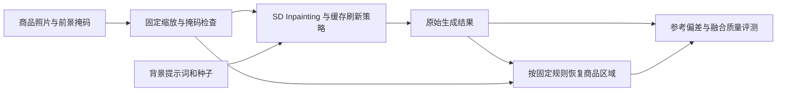

# 商品背景替换：区域感知扩散缓存设计

日期：2026-11-06。状态：首轮设计，尚未下载新模型、实现新管线或开展新实验。

现有通用文生图基线已保存为 Git 提交 `2623588`。本设计是该提交之后的未提交改动，须经用户审批后方可提交。既有三轮结果保持原样。

## 1. 任务与研究问题

输入商品照片、固定前景掩码及背景文字描述，输出保持商品位置与外观的场景图。例如：将同一双鞋放在摄影棚台面、木质桌面或室外石台上。

推荐题目：**面向商品背景替换的区域感知扩散特征缓存加速**。

核心研究问题：在相近推理时间或相同完整刷新预算下，显式关注商品轮廓附近的缓存误差，能否比通用的全图误差校准更好地保持背景生成与主体衔接？

待检验假设：

- H1：大面积背景会主导全图均方误差，轮廓附近的局部退化可能被全图平均掩盖。
- H2：对编辑区域与外侧轮廓带加权的校准，可在基本不增加在线网络计算的情况下降低局部参考偏差。
- H3：主体占比、细长结构与轮廓复杂度会影响缓存策略的表现；这属于机制分析，不能预先声称复杂边界必然需要更多刷新。

本项目保留生成模型权重，研究缓存与计算分配。DeepCache 已支持 inpainting；“接入背景替换”属于工程适配，候选贡献是任务相关的误差建模、受控实验及其适用边界。

## 2. 最小系统与产品行为



第一阶段由数据集或人工提供掩码，不把自动分割列为主要研究变量。交互演示可稍后接入 rembg，但其耗时与失败须单独记录。

使用二值前景掩码 F：1 表示商品，0 表示背景。传入 Diffusers 的重绘掩码为 E = 1 - F，白色区域重绘。保存以下三种产物：

1. 原始输入与掩码；
2. 未贴回商品的原始生成图 G；
3. 合成输出 Y = F * I + (1 - F) * G。

合成规则对所有方法完全一致。Y 的前景像素与输入相同，是硬合成的确定性结果，不能作为缓存质量提升证据。检查 G 可揭示模型造成的主体漂移和重复物体。接触阴影与新场景的光照协调仍由模型决定，不承诺得到物理正确的重光照。

主实验固定商品位置，不同时加入重定位、透明物体、复杂抠图、ControlNet 或商品 LoRA。前景须为不透明物体；玻璃、半透明材质和强反射材质列为后续失败分析。

## 3. 模型与当前代码适配

候选底模为 `stable-diffusion-v1-5/stable-diffusion-inpainting`，使用 `StableDiffusionInpaintPipeline`。模型卡说明其 U-Net 在原噪声输入之外，还接收掩码及被遮罩图像的编码，共 9 个输入通道。现有普通文生图底模不能直接视为这个专用底模。

首轮配置：512×512、FP16、batch=1、CFG=7.5、DDIM50、eta=0、strength=1.0、clip_sample=False，先固定 branch=0。记录新的模型 revision、实际配置、文件校验值和依赖版本。

可复用的部分：

- `src/cache_policy.py`：刷新列表、官方模块边界与动态规划；
- `src/error_calibration.py`：CFG 合并、DDIM 单步误差系数；
- 现有 GPU 计时、显存统计、配对分析与报告方式。

需要新增的部分：

- 图像与掩码加载、变换、条件潜变量构建；
- 支持 image、mask_image、masked_image_latents 的 inpainting runner；
- 编辑区域和外侧轮廓带的误差统计；
- 原始图与合成图分开保存、区域评测及应用质量记录。

不能直接复用 `Runner.generate()` 的调用方式：它目前只传文本和初始 latent，没有图像条件。第一阶段采用独立 runner，避免修改已冻结的文生图实验行为。

公平配对时，各方法共享同一张预处理输入、掩码、提示词、标准正态初始噪声，以及相同的 masked_image_latents。条件图像采用固定 VAE 编码方式，例如 posterior mode，避免编码采样成为额外随机变量。DPM 方法仍按自身 scheduler 规定处理初始噪声尺度，不强行覆盖内部采样语义。

每个图像／提示词／种子组合都重新建立缓存，不跨商品、提示词或种子共享特征。

## 4. 主改进：编辑区域与轮廓带加权的误差校准

先完成与当前方法相同的离线反事实探测：在无缓存参考轨迹的相同输入处，测量旧缓存导致的 CFG 噪声预测误差。区别在于保留其空间分布，而不是立即对整幅潜变量取平均。

设 q(a,i,p) 为在第 a 步刷新、在第 i 步复用时，位置 p 上跨通道平均的 CFG 噪声预测平方误差。定义：

- E：背景编辑区域；
- R：前景向外膨胀形成的轮廓带，R = dilate(F,r) - F，且 R 是 E 的子集；
- r 首轮固定为 512 分辨率下 16 像素，作为实验设定而非经验最优值；
- W_lambda(p) = E(p) * (1 + lambda * R(p))。

图像掩码使用相同坐标变换，权重映射到潜变量网格时采用面积覆盖率，记录该操作，不将潜变量位置直接解释为独立像素感受野。

局部代价：

```text
e_lambda(a,i) = c_i^2 * sum_p(W_lambda(p) * q(a,i,p)) / sum_p(W_lambda(p))
C_lambda(a,b) = average_calibration_cases(sum_{i=a}^{b-1} e_lambda(a,i))
```

c_i 是已有 DDIM 更新公式中对噪声预测的系数。归一化避免主体大小直接改变损失总量；各校准案例等权。拒绝空编辑区域，轮廓带消失时退化为编辑区域代价并记录。

使用现有动态规划在固定 B 次完整刷新、包含第 0 步、最大间隔 6 的约束下求刷新列表。主预算从 B=17 开始。验证集仅比较 lambda={0,1,3}，冻结选择后再运行测试。lambda=0 是编辑区域加权的必要对照，另保留全图代价对照。

第一阶段只生成一份全局刷新列表；推理时不额外执行完整 U-Net，不引入逐像素稀疏计算。该目标仍是参考轨迹上的局部代理，不能保证最终图像最优，必须以完整生成轨迹验证。

若先导实验显示主体几何确有明显影响，第二阶段才增加按掩码复杂度选择策略。分组阈值、策略数量及校准样本量必须重新设定，不能在测试结果上反复挑规则。

## 5. 数据与划分

主评测优先从 DIS5K 等带精细前景掩码的公开数据中筛选商品形态的物体照片。它是分割数据，不能声称是标准电商背景替换基准。正式下载前先核对获取方式和数据说明；若符合条件的对象不足，缩小类别或补充自行拍摄并人工标注的商品图，冻结实际来源。

优先考虑鞋、包、容器、家具或摆件。筛选要求只依赖输入：主体清晰、掩码可用、无明显裁切、不透明、主体面积约占画面 10%–70%。图像和掩码采用一致的等比缩放与填充，不拉伸主体；对由缩放损失掉的细结构作记录。

建议起始规模为 48 个不同商品／物体身份：8 个校准、8 个验证、32 个测试。相同身份的所有照片、背景提示词和种子都属于同一划分，近重复图像也按同组处理。

每个测试对象配 3 类背景提示词与 2 个种子，得到 192 个配对案例。5 个主方法共 960 张原始生成图；合成图是派生产物，不增加独立样本数。若身份数量不足，在生成测试结果前缩减并重新记录协议，不用重复种子凑独立样本数。

三类背景模板可为摄影棚台面、室内材质台面、室外展示台。模板包含物体名与场景描述，避免把物体类别变化引入方法比较。校准与验证覆盖各背景类型，测试提示词在查看输出之前固定。

另选少量自行拍摄的真实商品作演示。演示结果与正式测试统计分开，不只展示成功案例。

## 6. 对照、指标与分析

主方法建议如下，全部使用同一 inpainting 底模与预处理：

| 方法 | 作用 |
|---|---|
| DDIM50 无缓存 | 同输入参考输出和原始延迟 |
| DeepCache 均匀刷新，B=17 | 官方缓存机制的基本对照 |
| 全图 DDIM 误差校准，B=17 | 在新任务上重新校准，避免把换域收益归因于区域加权 |
| 编辑区域／轮廓带校准，B=17 | 候选主方法；lambda 仅在验证集选择 |
| 无缓存 DPM-Solver++ | 另一类加速方法；步数用验证延迟选择后冻结 |

旧文生图策略直接迁移、lambda=0、不同轮廓带宽、预算 10/17/25 放在预先选定的小规模消融中。旧策略迁移主要解释域变化，不代替在新任务上校准的强对照。

评测分为以下几类：

- **参考偏差主指标**：对相同输入的无缓存 DDIM 输出，在固定轮廓 ROI 上计算 LPIPS 距离。ROI 由输入掩码轮廓确定为固定大小局部块，例如 128×128，块中心按轮廓长度确定性等距采样；与参考使用相同块，先在案例内平均。采样规则在验证阶段冻结，不能按输出质量选块。
- **区域诊断**：原始生成图的背景与外侧轮廓带像素误差；全图 LPIPS 作为补充。不要将掩码外置零后计算的 LPIPS称为严格的区域感知距离，置零边缘会影响卷积特征。
- **应用质量**：合成图的背景提示词符合程度，以及轮廓光晕、重复主体、接触阴影、背景残留等缺陷。CLIP 图文余弦只是辅助，不充分反映边缘与融合。
- **盲评**：预先固定测试子集、随机左右位置、隐藏方法名称，分别评价背景符合度与衔接自然度，允许平局。只有实际取得人的评价后才报告人工偏好；否则交付盲评材料并说明未完成人工评测。单人评价单独标注。
- **工程性能**：端到端背景替换时间、U-Net 时间、峰值 allocated/reserved 显存、缓存占用、实际完整刷新次数和刷新日志。另报固定输入条件下的去噪时间，避免预编码让端到端收益显得过大。

轮廓 ROI 距离仍只衡量对无缓存模型的保真。无缓存模型生成错误背景或阴影时，贴近该结果不代表应用质量更好。

主比较预先指定为区域校准减均匀缓存的轮廓 ROI LPIPS，另以区域校准减全图校准检查机制。主方法须同时报告全图偏差和背景质量，防止仅优化轮廓而损害大面积背景。方法选择不使用测试分数。

统计以商品身份为配对 bootstrap 单位，同一商品的全部提示词和种子留在同一簇，先在商品内平均。预先指定一个主比较，其他比较为次要分析；不把“差异不显著”解释为质量等价。

计时顺序随机并先暖机。对固定子集做重复计时，区分每案例一次测量与重复性能验证。校准、条件编码、可选分割、合成和质量评估的时间分别记录。

## 7. 实现文件与分阶段验收

以下文件是拟新增项，尚未实现：

| 文件／目录 | 职责 |
|---|---|
| `src/background_task.py` | 掩码语义、同步预处理、条件编码与固定合成规则 |
| `src/region_cost.py` | 编辑区域、轮廓带、空间归一化与校准代价 |
| `scripts/prepare_background_assets.py` | 单独下载并固定新模型、筛选数据、建立来源清单 |
| `scripts/run_background.py` | smoke、calibrate、validate、test 分阶段执行 |
| `scripts/evaluate_background.py` | 区域指标、配对分析、盲评材料与完整图表 |
| `manifests/product_background.json` | 商品身份、来源、掩码、划分、模板、种子与协议 |
| `results/product_background/` | 新任务独立记录，图像在本地保存并由 Git 忽略 |

**M1：适配与最小验证。** 独立于正式测试准备 4 个有掩码案例，先用短采样检查掩码方向、9 通道条件、缓存清理及输入一致性；验证间隔 1 等价无缓存、同刷新列表等价官方 helper，再实测一次 DDIM50 的延迟和显存。若精确像素等价失败，先报告最大差值和潜变量误差，定位原因后决定可接受阈值，不能无说明放宽。

**M2：校准与验证。** 完成全图、编辑区域、轮廓带三种目标，记录代理代价与实际完整轨迹结果的关系，检查错误是否集中在轮廓。根据验证集冻结候选方法、区域参数和 DPM 步数。该阶段可得出区域加权无效的结果，不能保证正收益。

**M3：独立确认与演示。** 在保留的测试身份上运行冻结方法，输出全部指标、置信区间、固定顺序案例、失败类型和盲评材料。制作“输入／掩码／原始生成／合成输出／时间”的轻量演示；界面不列为算法贡献。

每个阶段完成后先提交工作区差异与验证结果供用户审批，批准后才创建 Git 提交。初始基线的授权不延伸到上述提交。

## 8. 资源、失败判据与后续扩展

当前 RTX 5060 Laptop 8GB 已跑通普通 SD1.5，不代表专用 inpainting 模型已完成显存验证。先卸载旧生成模型，再加载新管线；校准轨迹放 CPU 或仅保留必要统计，质量评估模型与生成模型错峰加载。

如需 CPU offload，所有对照采取相同策略，并重新测量整个系统，不能沿用现有 2.37 倍加速结论。新增预训练权重和原始商品图放在已忽略的 models 与 data/raw 下，不提交进 Git。

发生下列情况时优先缩小范围或如实报告：

- 无缓存背景替换本身质量很差：先确认模型、提示词、掩码和合成流程，缓存无法修复底模能力。
- 区域代价改善但真实输出无收益：说明局部代理不足，下一步再研究缓存实际轨迹上的误差传播。
- 轮廓更接近参考、背景语义或融合更差：报告权衡，不以单个指标宣布整体质量提升。
- 复杂掩码样本不足：只做探索性分组分析，不宣称已确认复杂度自适应。

主线成立后，才考虑羽化边缘、掩码扰动鲁棒性、按几何选择刷新列表、不同缓存深度或更高分辨率。每项作为独立变量，避免同时加入多种条件模型而无法归因。

## 9. 一手资料

1. [DeepCache 官方仓库](https://github.com/horseee/DeepCache)：已有 inpainting 支持和官方缓存机制。
2. [Stable Diffusion Inpainting 模型卡](https://huggingface.co/stable-diffusion-v1-5/stable-diffusion-inpainting)：专用模型及附加条件通道。
3. [Diffusers 0.35.1 Inpainting API](https://huggingface.co/docs/diffusers/v0.35.1/en/api/pipelines/stable_diffusion/inpaint)：掩码方向、masked_image_latents 与采样输入。
4. [DIS 官方仓库](https://github.com/xuebinqin/DIS)：精细前景掩码候选数据；实际子集仍待筛选。
5. [rembg 官方仓库](https://github.com/danielgatis/rembg)：可选交互演示的前景提取组件，不作为第一阶段主实验变量。
